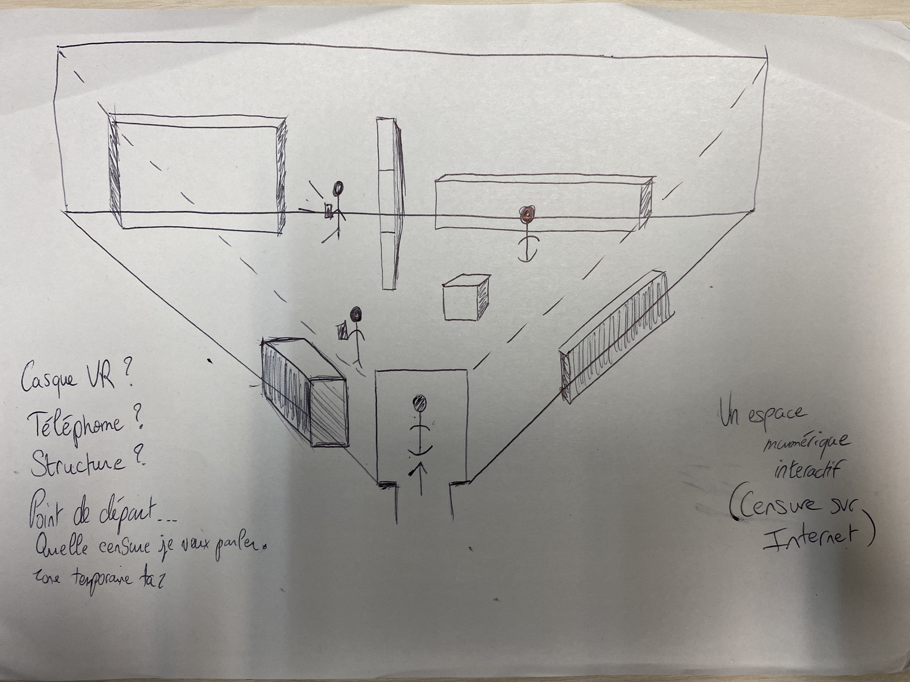
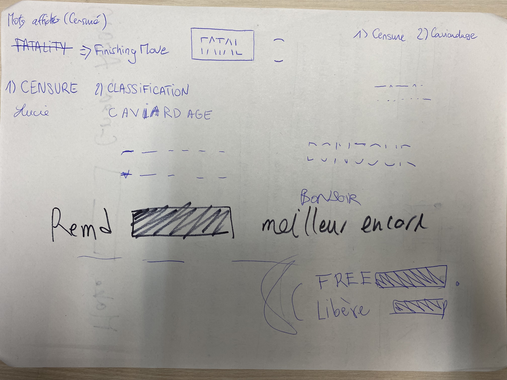

Projet d’un espace numérique interactif

La thématique : La Censure sur Internet 

Créer un espace d’interaction avec des oeuvres, des sites, des artistes censurés 

Matériel : Casque VR ? Téléphone ? Structure ?

La Censure de Localisation d'un jeu video

Faire des comparaison entre un jeu avec version original et la version dans laquel le jeu est distribue.
En fonction de la politique d'un pays et ses accords de confidentialite, un jeu video peut subir des modifications importantes ou des details.

Pour qu'un jeu soit jouable est distribué légalement dans les pays suspectible d'interdire un jeu, l'editeur ou le studio doit suivre des processus d'adaption technique, juridique et culturelle.

Un jeu vidéo peut recevoir plusieurs version différentes d'un pays à l'autre.

Nouveau termes appris : Le CAVIARDAGE
C'est caché une partie d'un mot ou d'une phrase.

